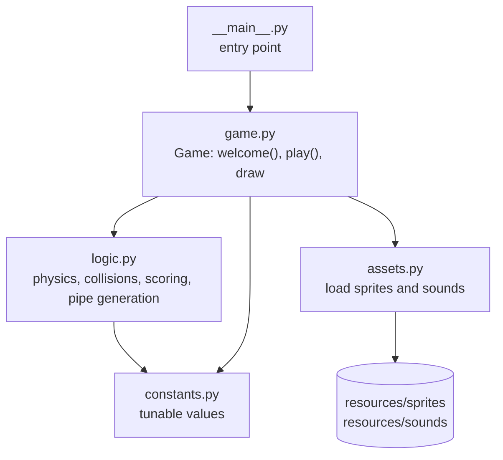
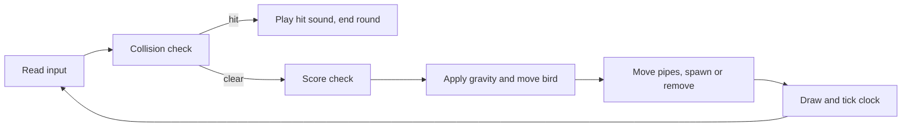

# WingDash

A side-scrolling flap-and-dodge game written in Python with pygame. Tap to flap, slip through the gaps and score a point for every pipe you clear.

## Features

- Gravity and flap physics with a velocity cap
- Randomly placed pipe pairs with a constant gap, spawned endlessly
- Score shown with digit sprites, plus sound effects for flap, point and hit
- Welcome screen, instant restart after a crash
- Runs without an audio device (sounds fall back to silence)
- Game rules kept in a pygame-free module (`logic.py`) and unit tested

## Controls

| Key | Action |
|---|---|
| `Space` or `Up` | Start the round, flap |
| `Esc` or close window | Quit |

## Architecture



Each frame of `Game.play()`:



`logic.py` and `constants.py` import no pygame, so the rules can be tested on any machine without a display.

## Project structure

```
src/wingdash/
  __main__.py              entry point
  game.py                  pygame loop and drawing
  logic.py                 pure game rules
  assets.py                asset loading
  constants.py             tunable values
  resources/
    sprites/               bird, pipes, base, background, digits
    sounds/                wing, point, hit, die, swoosh
tests/
  test_logic.py            unit tests for the rules
  test_assets.py           asset presence and headless loading
.github/workflows/ci.yml   lint and test on every push
```

## Run

Requires Python 3.9 or newer.

```bash
python -m venv .venv
source .venv/bin/activate        # Windows: .venv\Scripts\activate
pip install .                    # installs pygame, the assets and the wingdash command
wingdash                         # or: python -m wingdash
```

The sprites and sounds ship inside the package, so a regular install works from any directory. Use `pip install -e .` while developing.

## Tests and lint

```bash
pip install -r requirements-dev.txt
pytest
ruff check .
```

The tests cover gravity and its velocity cap, ground stop, bounds and pipe collisions (including edge touches), the scoring window, the fixed gap and on-screen placement of generated pipes, seeded reproducibility, and that every sprite and sound ships with the package. CI sets `SDL_VIDEODRIVER=dummy` and `SDL_AUDIODRIVER=dummy` so the asset-loading test runs without a display. The tests are written but have not been run in CI yet.

## Limitations

- No high-score storage, pause, difficulty levels or menu
- Physics is stepped once per frame at a fixed 32 FPS cap, so on a slow machine the game runs slower rather than skipping frames
- Collision uses the bird's left edge against the pipe position, a simple approximation rather than pixel-accurate hit boxes
- The drawing loop is not covered by automated tests
- Asset provenance is unconfirmed. The sprites and sounds may carry their own licenses, so confirm their source and terms (or replace them) before redistributing.

## Roadmap

- Persist the best score
- Pause and quit-to-menu
- Frame-rate independent movement with a fixed time step
- Pixel-accurate or rectangle-based collision boxes
- A game-over screen showing the final score

## License

Source code is MIT. See [LICENSE](LICENSE).
