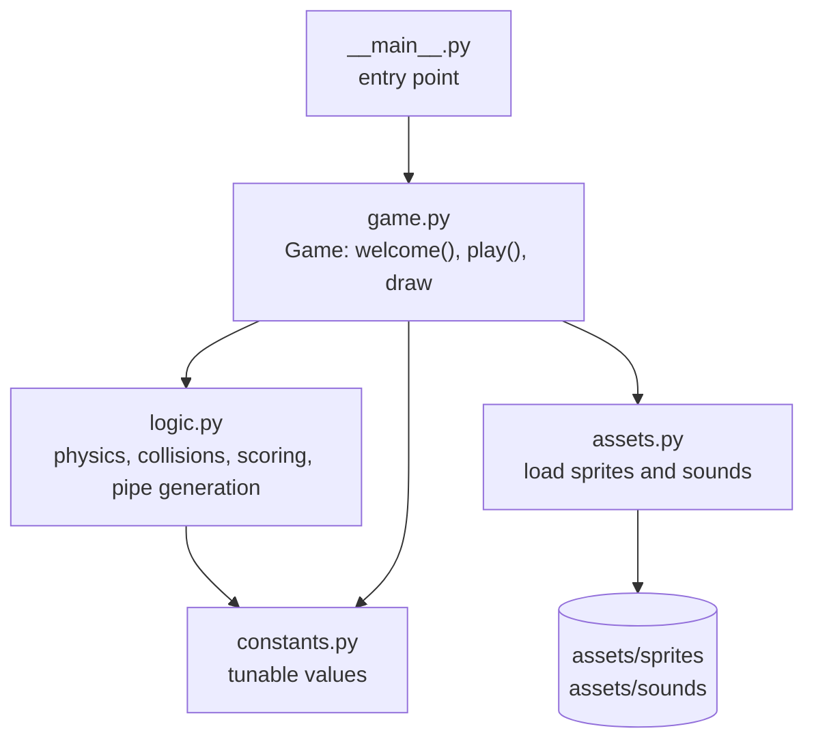
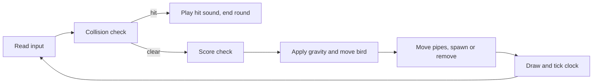

# WingDash

A side-scrolling flap-and-dodge game written in Python with pygame. Tap to flap, slip through the gaps and score a point for every pipe you clear.

## Features

- Gravity and flap physics with a velocity cap
- Randomly placed pipe pairs with a constant gap, spawned endlessly
- Score shown with digit sprites, plus sound effects for flap, point and hit
- Welcome screen, instant restart after a crash
- Game rules kept in a pygame-free module (`logic.py`) and unit tested

## Controls

| Key | Action |
|---|---|
| `Space` or `Up` | Start the round, flap |
| `Esc` or close window | Quit |

## Architecture



Each frame of `Game.play()`:



`logic.py` and `constants.py` import no pygame, so the rules can be tested on any machine without a display.

## Project structure

```
assets/
  sprites/                 bird, pipes, base, background, digits
  sounds/                  wing, point, hit, die, swoosh
src/wingdash/
  __main__.py              entry point
  game.py                  pygame loop and drawing
  logic.py                 pure game rules
  assets.py                asset loading
  constants.py             tunable values
tests/test_logic.py        unit tests for the rules
.github/workflows/ci.yml   lint and test on every push
```

## Run

Requires Python 3.9 or newer.

```bash
python -m venv .venv
source .venv/bin/activate        # Windows: .venv\Scripts\activate
pip install -e .                 # installs pygame and the wingdash command
wingdash                         # or: python -m wingdash
```

Install in editable mode (`-e`): assets are read from the repository's `assets/` directory.

## Tests and lint

```bash
pip install -r requirements-dev.txt
pytest
ruff check .
```

The tests cover gravity, ground stop, bounds and pipe collisions, the scoring window and the fixed gap of generated pipes.

## Limitations

- No high-score storage, pause, difficulty levels or menu
- The drawing loop and sounds are not covered by automated tests
- Asset provenance is unconfirmed. The sprites and sounds are not original work by the author and may carry their own licenses. Confirm their terms or replace them before redistributing.
- Assets load from the checkout, so a non-editable install will not find them

## Roadmap

- Persist the best score
- Pause and quit-to-menu
- Package the assets inside the Python package

## License

Source code is MIT. See [LICENSE](LICENSE).
